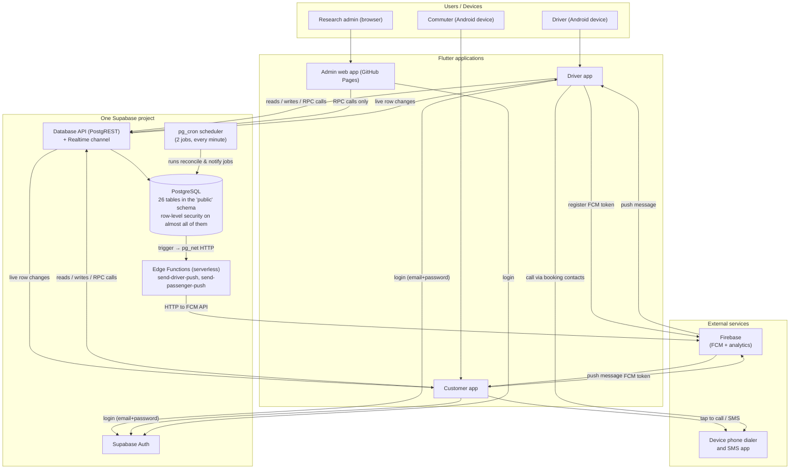

# 2 · System Architecture

## The one-sentence architecture

PASAKAY is three Flutter clients (two Android apps and one web app) that talk
to a single Supabase project: the mobile apps call the database directly for
reads and workflow actions, and every row they can see is filtered by the
database itself, so the server — not the app — decides what each user is
allowed to do.

## Architecture diagram

## What each colored block means, in plain English

### The three applications

- **Driver app** — what a tricycle driver installs on their phone. Its home
  screen is the *Bookings* tab: incoming ride requests appear there in real
  time, and once a request is accepted, the trip's status card appears
  underneath. Other tabs show reviews, past trips ("Recents"), notifications,
  and the driver's own profile.
- **Customer app** — what a commuter installs. Its home screen is the
  *Terminals* list; from there they drill into a terminal, see the drivers on
  the current shift, open a driver's profile, and contact or request a ride
  from that driver. Other tabs: History (their bookings), Review,
  Notifications, Profile.
- **Admin web app** — a browser console for the research team's administrator.
  Every screen is a thin wrapper over PostgreSQL functions (RPCs); the admin
  app never reads or writes tables directly except a few list screens, so the
  database enforces each rule ("you may only delete a terminal with no
  drivers", for example).

There is **no custom web server** in this project. The phrase "backend" here
means the Supabase-hosted PostgreSQL database plus a small set of serverless
functions.

### The database (the core of the system)

The interesting design fact for a defense: **most business rules live inside
the database, not in the Flutter code.** Twenty-six tables are grouped in the
`public` schema, and nearly all of them have *Row Level Security* (RLS) —
PostgreSQL policies that automatically hide or block rows a user doesn't own.
On top of the tables sit 94 PostgreSQL functions that implement the real
workflows:

- `register_driver` / `register_commuter` validate mobile numbers, unique
  usernames, TODA plates and terminals, create the auth user and the profile
  row in one transaction.
- `create_ride_request`, `accept_ride_request`, `reject_ride_request`,
  `complete_booking`, `flag_booking`, `report_driver_booking`,
  `submit_booking_review` implement the ride lifecycle and throw descriptive
  exceptions when a rule is violated ("Driver is outside their scheduled
  operating period", "The dispute window for this booking has expired").
- `reconcile_ride_workflow` runs **every minute** (via `pg_cron`, the database
  scheduler) to expire old pending requests, auto-complete BOOKED bookings
  that were never finished and never flagged, and mark completed bookings as
  review-eligible.
- `admin_*` functions (28 of them) power the admin console, and each one
  re-checks that the caller really is a system admin via `assert_system_admin()`
  / `is_system_admin()`.

### Authentication and authorization

- **Authentication** (who you are) is done by Supabase Auth: the driver or
  commuter logs in with mobile number + password, which the app converts into
  a fixed email identity (e.g. `09181234567@<role-domain>`), matching how the
  account was provisioned at registration.
- **Authorization** (what you may do) happens in two layers: RLS policies
  filter every direct table read/write to the user's own rows (`commuter_id =
  auth.uid()`), and the workflow functions re-verify role and status inside
  the transaction, so a theoretically modified app could still not accept
  somebody else's request.
- The admin identity is just a row in an `admins` table linked to the same
  auth system; every admin function calls `assert_system_admin()` first.
- The pre-login gate (`get_login_status`) checks whether the account is
  pending, suspended or deactivated **before** showing Supabase's raw
  "account banned" error, so users get a readable message.

### External services

| Service | Used for | What the system would lose without it |
|---|---|---|
| Supabase Auth | password logins | sign-in |
| Supabase Postgres (+ RLS + functions) | all data and business rules | everything |
| Supabase Realtime | live updates of requests/bookings/notifications | live feel; apps fall back to manual refresh |
| Supabase Edge Functions + `pg_net` | turning "a notification row was inserted" into an FCM push | push notifications (in-app notifications still work) |
| Firebase Cloud Messaging | delivering pushes to Android devices | push notifications |
| GitHub Pages + Actions | hosting the admin console | admin app deployment (nothing runtime) |
| Device dialer / SMS apps | actual communication | the core "contact the driver" action |

### Dependencies and limitations of this architecture

1. **Internet is mandatory.** Every screen reads from the database; offline
   use shows empty data or an error state (the repos wrap failures and the
   UI shows previous or empty snapshots).
2. **The anon key is public.** Mobile apps ship the Supabase *anon* key, which
   is designed for this: security comes from RLS, not key secrecy. Passwords,
   service-role keys and FCM server credentials are never in the client.
3. **Push delivery depends on FCM availability**, and call/SMS passthrough
   depends on the device having a SIM/dialer — mobile Wallets without SIM
   cannot contact drivers.
4. **The admin console is hosted on GitHub Pages, so it is public** — but it
   shows nothing without an admin login, and every admin operation is
   blocked server-side by `assert_system_admin()`.

## Where the detailed diagrams live

`docs/system-analysis/flowcharts/` contains six validated diagrams that go
deeper: system context, startup, authentication, the ride workflow, database
interactions, and foreground activity/audit tracking. The one-page
end-to-end user journey is `docs/system-analysis/flowcharts/end-to-end-flow.mmd`.
