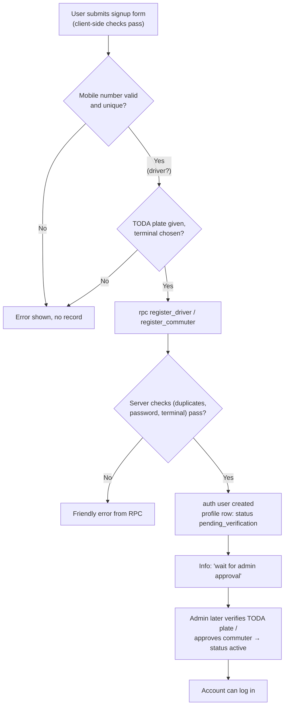
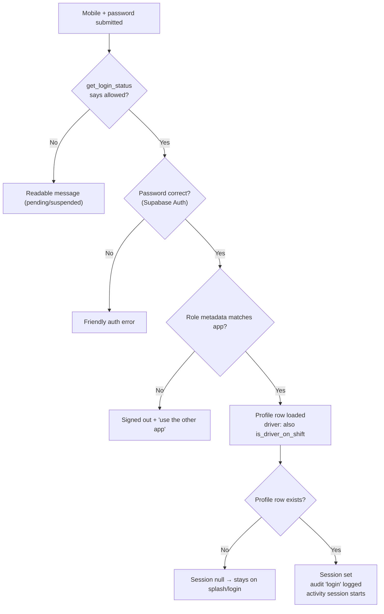
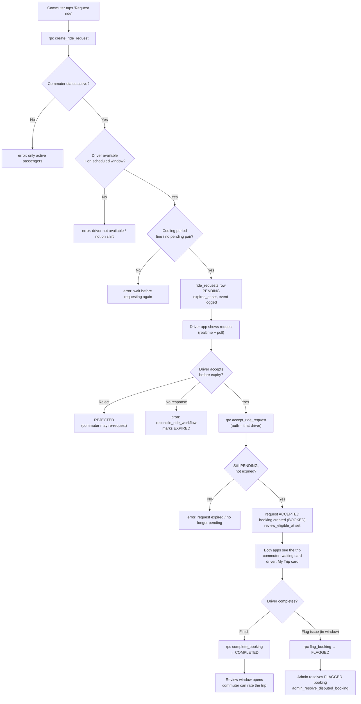
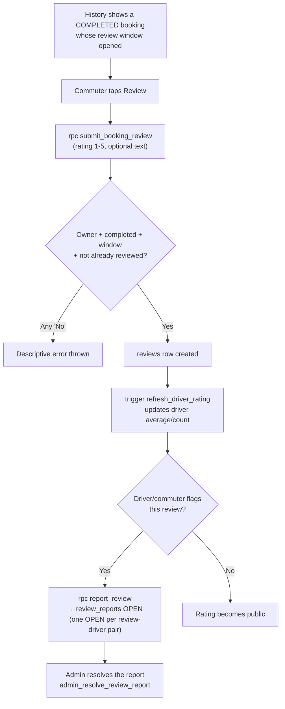

# 4 · Application Workflows

Each workflow below traces a real user click through the code to the database,
including the failure paths. Every table row of Mermaid was validated with
`mermaid-cli`; deeper diagrams live in `../system-analysis/flowcharts/`.

## 4.1 Registration → admin approval

**Initiated by:** commuter or driver, in the signup screen of their app.
**Starts in:** `apps/<role>/lib/features/signup/` → `AuthService.signUp`.
**User provides:** full name, mobile number, password; drivers also provide
TODA plate number and pick a terminal; both may add an email.

Validations: mobile normalize (`PhoneUtils.normalize`, PH format enforced),
TODA plate acceptance (`AuthValidators.normalizeTodaPlate`, freeform but not
empty), and the strongest set inside `register_driver` / `register_commuter`:
duplicate username/phone/email blocking, driver must have valid plate +
existing terminal, and the password policy. The auth user is provisioned via
`provision_auth_user`, its `role` metadata is stamped, and the profile row is
created with `status = 'pending_verification'`.

Failure paths: any RPC raise becomes a friendly error in the login screen
(`AuthFlowException`); the account is *not* left half-created because the
provisioning and profile insert happen inside one function.

## 4.2 Login

**Initiated by:** the user on `/login` (`LoginScreen`).
**What runs:** `SessionController.login` → `AuthService.login`:

1. `get_login_status` — friendly gate for pending/suspended/deactivated.
2. `resolve_auth_email` — mobile → provisioned email identity.
3. `auth.signInWithPassword` — the actual credential check.
4. Role assertion — if the account belongs to the *other* role, the app
   signs out and says so.
5. On success the driver/commuter profile is fetched, the driver's shift
   status is checked (`is_driver_on_shift`), an audit entry is written, and
   the foreground-activity session starts.

## 4.3 Ride request → booking → completion (the core loop)

Reference implementations:
- Customer side: `apps/customer/lib/services/customer_repository.dart`
  (`createRideRequest`, `fetchDriverRequestContext`, realtime subscriptions).
- Driver side: `apps/driver/lib/services/driver_repository.dart`
  (`acceptRideRequest` L140, `rejectRideRequest` L148, `completeBooking`
  L172, `flagBooking` L160).
- Server rules: `20260915130000_ride_request_booking_flow.sql`
  (`create_ride_request` L240, `accept_ride_request` L341,
  `reject_ride_request` L445, `reconcile_ride_workflow` L145 — cron every
  minute).

What the commuter can and cannot do: request only when the driver is actually
`is_active`, within their scheduled window (`is_driver_on_shift` logic),
available for another request, and not in cooldown; the messenger may cancel
before acceptance only by waiting for expiry (there is no cancel RPC).

Failures are user-visible by design, e.g. "Please wait before requesting this
driver again" (cooldown), "Driver is outside their scheduled operating period".

## 4.4 Review a trip (and report a review)

`submit_booking_review` rejects anything that is not the owner reviewer, is
not on a COMPLETED booking, is before `review_eligible_at`, or duplicates an
existing review for that booking. The same migration wires in
`review_reports` (driver or commuter contesting) and the
`admin_resolve_review_report` admin action.

## 4.5 Notifications (in-app + push)

1. A state change (shift updated / request accepted / trip finished /
   schedule day starting) calls `emit_notification` from a database function
   or trigger, which respects per-user preference toggles
   (`driver/commuter_pref_enabled`) and dedupes repeated reminders via
   `dedupe_key`.
2. `emit_notification` inserts into `notifications`.
3. The `trg_notifications_dispatch_push` trigger calls
   `dispatch_notification_push`, which uses `pg_net` to POST to the matching
   Supabase Edge Function (`send-driver-push` / `send-passenger-push`). The
   Edge Function looks up the recipient's FCM tokens from
   `device_tokens`/`commuter_device_tokens` and forwards the push to Firebase.
4. On the device, `PushNotificationService` also taps to route into the app
   (deep link via `onOpenRoute` in both mobile apps).

What happens if FCM or an Edge Function is unavailable: the `notifications`
write itself does not fail the user's action because push dispatch is
asynchronous; the in-app row still exists. Push retries are **unverified** —
the Edge Functions call FCM once and log server-side errors; there is no
retry queue in this codebase.

## 4.6 Admin actions

The admin console covers: overview metrics, driver management (create, edit,
verify TODA plate, suspend/activate, delete, reset password), commuter
access control, terminal add/rename/delete (guarded), shift label/time edits
(3 fixed shifts!) and driver shift-change requests, booking settings
(dispute window, request expiry, cooldown, review delay), review moderation,
dispute resolution, and privacy-request logging.

Every admin call is funneled through functions that call
`assert_system_admin()` — a malicious or mistake-prone client cannot bypass
it because the check runs inside the database.

## 4.7 Foreground tracking + audit logging (both mobile apps)

Independent of any user-visible feature and used purely for the research
evaluation: a `Timer` sends a `heartbeat` every ~30 s while the app is in the
foreground; when the app is minimized the session ends with reason
`background`. Sessions/heartbeats write through
`report_driver_activity` / `report_commuter_activity` (role deduced from the
auth id server-side). The same pattern also powers the audit trail — screens
and key in-app actions (login/logout, opening the booking/terminals screens,
submitting a review, calling the driver, etc.) are recorded in
`user_audit_logs` through `report_user_audit_log`. Audit failures are silent
by design: logging never blocks the user's action.

## 4.8 What is *not* traceable end-to-end

- Push delivery confirmation (relying on FCM logs; no in-repo evidence).
- Exact handling of FCM deep-link routes for every notification category
  (routing code exists and is unit-tested for known categories, but no
  push-through delivery test).
- `apps/admin/lib/features/privacy` and `.../diagnostics` screens are
  **not wired into the admin router** (see `docs/defense/08-limitations-and-scope.md`);
  their effects were not exercised at runtime during this documentation pass.
